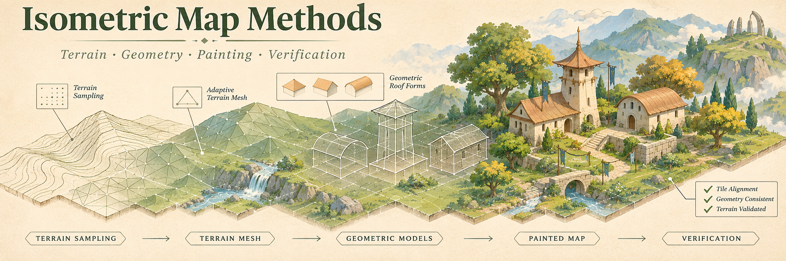

# Isometric Map Methods



Methods, a working toolkit and a complete written reference for terrain-aware isometric maps. The maps can be turned, lit for any date and time, and walked through at eye level. Everything here can be rebuilt by a person without AI: the algorithms are specified with their formulas and constants, the code is plain JavaScript and Python with no dependencies beyond NumPy, and the data is public.

**Public data only.** This repository contains no site datasets, building models, directory records, map tiles, operational endpoints or deployment details. The method tests create synthetic inputs. The one exception is a deliberately small open-data sample (a neighbourhood park, 130 × 132 m, plus a CC0 star list) in [`sample/`](sample/README.md), which keeps its own licences. The banner is fictional.

## Start here

| If you want to | Read or run |
| --- | --- |
| See a map in two minutes, offline | `node toolkit/build.mjs --sample --out=work/sample`, then open `work/sample/map.html` |
| Make a map of your own small area | [toolkit/README.md](toolkit/README.md): download three public files, then `build.mjs` |
| Learn the methods step by step | [tutorial/README.md](tutorial/README.md): eight short steps on the sample |
| Rebuild the full system by hand | [public-docs/RECREATE.md](public-docs/RECREATE.md) (the workflow) and [public-docs/ALGORITHMS.md](public-docs/ALGORITHMS.md) (every algorithm and constant) |
| Release it the careful way | [public-docs/RELEASE_METHOD.md](public-docs/RELEASE_METHOD.md) |


*Tutorial preview from © OpenStreetMap contributors (ODbL), USA Structures: ORNL and FEMA Geospatial Response Office (CC BY 4.0), and U.S. Geological Survey 3DEP elevation (public domain).*

## The toolkit

```bash
node toolkit/build.mjs --sample --out=work/sample                                     # the bundled sample, offline
node toolkit/build.mjs --source=work/myarea/source --bbox=W,S,E,N --out=work/myarea  # your area: map.osm, dem.tif, structures
```

`map.html` is one self-contained file. Open it in any browser with WebGL2: no server, no network, no account. It draws:

- crack-free terrain and buildings whose heights say where they came from;
- roofs, windows that light up at night, and seasonal trees;
- the real sun with soft shadows;
- the moon and stars where they are for the chosen time;
- a ground-level walk that cannot pass through walls.

For your own area, download an OpenStreetMap export, a USGS 3DEP elevation tile and (in the US) USA Structures from the publishers' own download pages; the [toolkit README](toolkit/README.md) gives the steps. A download script, `fetch.mjs`, is included too, but it obeys each host's `robots.txt` and fails closed, and on 2026-11-15 all three services refused automated access, so it stops by design.

## The methods

| Module | Purpose |
| --- | --- |
| [terrain.mjs](methods/terrain.mjs) | Crack-free triangulation where terrain cells of different sizes meet |
| [projection.mjs](methods/projection.mjs) | Orthographic projection and its inverse at a known height |
| [buildings.mjs](methods/buildings.mjs) | Oriented box, height by source priority, seating on slopes, roof forms, facade bays |
| [roof.mjs](methods/roof.mjs) | Parametric saddle (hypar) surface |
| [collision.mjs](methods/collision.mjs) | Swept movement against wall segments, push-out, gaps at gates, walls sliced from a mesh |
| [graph.mjs](methods/graph.mjs) | Networks from mapped lines, A*, the strongly connected core, pruning by walls |
| [ground.mjs](methods/ground.mjs) | Mode-aware routes, observer poses, swept boxes and stopping caps |
| [sky.mjs](methods/sky.mjs) | Sun, moon, sidereal time, star visibility, light and season weights |
| [traffic.mjs](methods/traffic.mjs) | Car following (IDM), lanes, junction zones, U-turns, turn preferences |
| [roles.mjs](methods/roles.mjs), [conversation.mjs](methods/conversation.mjs) | Weighted stops for fictional roles; brief replies with one owner |
| [motion.mjs](methods/motion.mjs) | Animation of confirmed live positions with stale and out-of-order guards |
| [lidar.mjs](methods/lidar.mjs) | Surface and ground rasters, roof levels, model agreement, audit classes |
| [packs.mjs](methods/packs.mjs) | Content-addressed data packs; appearance versus label hashes |
| [raster.py](methods/raster.py) | Alignment, semantic compositing, bounded colour gains and overlap blending |
| [provenance.py](methods/provenance.py) | Immutable settings hashes and file manifests |

## Run the checks

Use Node.js 22+ and Python 3.12+. There are no JavaScript dependencies, and NumPy is the only Python dependency.

```bash
python3 -m venv .venv
.venv/bin/python -m pip install -r requirements.txt
npm test                                                     # methods, tutorial and toolkit
.venv/bin/python -B -m unittest discover -s method-tests -p 'test_*.py' -v
```

Nothing is downloaded and no key or GPU is needed. `npm test` also runs the tutorial and builds the sample map.

## Read the workflow

- [Algorithms](public-docs/ALGORITHMS.md): the complete reference, from coordinate frames to traffic, lidar fitting and tile pyramids.
- [Recreating without AI](public-docs/RECREATE.md): the order of work, who does what, and when each stage is done.
- [Methods and limits](public-docs/METHODS.md): what each module assumes and where it stops.
- [Ground-level movement](public-docs/GROUND_LEVEL.md): routing, contact, fictional roles and brief replies.
- [Public sources](public-docs/DATA_SOURCES.md) and the [sample](sample/README.md): licences, attribution and terms.
- [Reproducibility](public-docs/REPRODUCIBILITY.md): inputs, settings, resume rules and what the tests cover.
- [Release method](public-docs/RELEASE_METHOD.md): gated, reproducible releases of a site, a regenerated layer, or this repository.
- [Publication boundary](public-docs/PUBLICATION.md): how this repository is kept to methods and public data.
- [Skills](public-skills/README.md): step-by-step procedures, usable by a person as checklists or by an agent.
- [Banner provenance](public-docs/BANNER.md): fictional illustration and its prompt.

## Licence and contributions

Code and documentation use [Apache-2.0](LICENSE). It does not grant rights to external datasets or to anyone's names and marks.

- **Data licences:** the files in `sample/` keep their own licences (ODbL, CC BY 4.0, public domain, CC0), and so does anything rendered from them, including `tutorial/preview.png`. Data you fetch with the toolkit stays under its publishers' terms.
- **The banner:** it is AI-generated and is included under the repository licence to the extent rights are available. No exclusive copyright is claimed for AI-generated content.

See [CONTRIBUTING.md](CONTRIBUTING.md) and [SECURITY.md](SECURITY.md). Contributions must use synthetic examples or public data with a redistribution licence.
